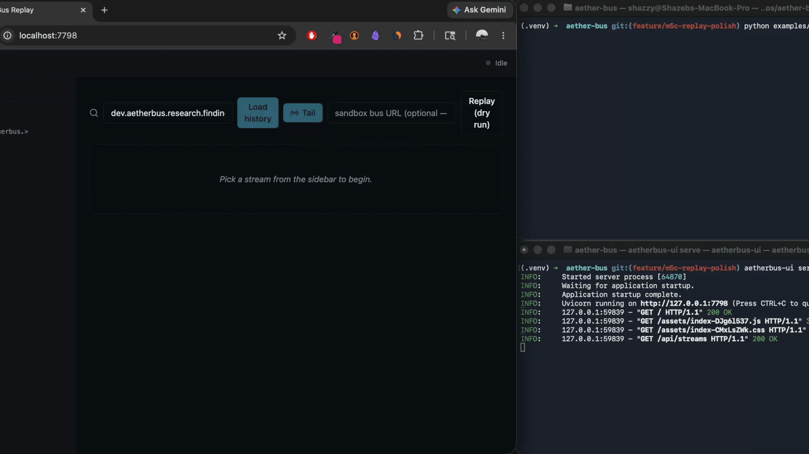

# AetherBus

> **Event-driven context layer for AI agents.** CloudEvents over NATS / Kafka, with pointers — not payloads — and an MCP adapter so any MCP-capable client can consume the stream.

## Why it exists

Three independent forces converge in 2025–2026 and leave a precise gap:

1. **Multi-agent systems waste tokens at predictable rates.** Anthropic's June 2025 engineering post benchmarks them at ~15× the tokens of single-chat. CrewAI's role/goal/backstory pattern adds ~18% overhead vs. LangGraph on identical workloads. GitHub's MCP server burns 17,600 tokens on tool definitions before any work happens.
2. **The pointer pattern has already won.** Anthropic's research-agent post: subagents *"write to a shared filesystem and return a lightweight reference."* Cognition's "Don't Build Multi-Agents" argues for shared traces. Everyone is doing claim-check by hand; nobody has shipped the library.
3. **MCP has the primitive but nobody uses it.** The spec defines `resources/subscribe` and `notifications/resources/updated` — marked optional and, per MCP discussion #301, not implemented by Claude Desktop or FastMCP.

AetherBus is the convention layer that closes the gap. Events carry a `dataref` URI; subscribers resolve content on demand from `mcp://`, `vec://`, `git://`, `file://`, or `https://`.

## Quick links

-   **[Quickstart](quickstart.md)** — three working examples in 20 lines each: raw bus, MCP wedge, LangGraph node.
-   **[Replay UI](replay-ui.md)** — open `aetherbus-ui serve`, watch events flow, click an event for the full envelope, fork-from-here into a sandbox.
-   **[Architecture](architecture/index.md)** — system diagram, envelope format, transport semantic translation table, five ADRs.
-   **[Reference](reference/bus.md)** — `Bus`, `Event`, `EventPayload`, the resolver SDK, framework adapters.

## What it is *not*

- Not a new agent framework — adapts to LangGraph, CrewAI, OpenAI Agents SDK.
- Not a new wire protocol — CloudEvents 1.0 + AsyncAPI 3.0, no new fields beyond documented extension attrs.
- Not a hosted service — self-hosted only; broker is NATS JetStream (default) or Kafka.
- Not a competitor to MCP or A2A — sits between them as the async, many-to-many, replayable layer.

## License

Apache 2.0. Source: [github.com/ShazebA/aetherbus](https://github.com/ShazebA/aetherbus).
