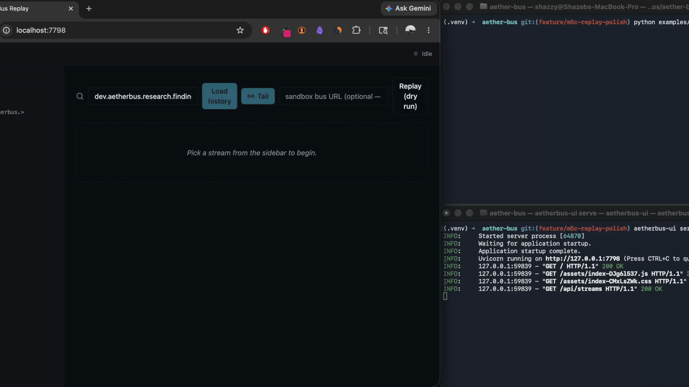

# Replay UI

The portfolio money shot. A loopback-only FastAPI backend exposes the bus over REST + WebSocket; a Vite + React + Tailwind SPA renders it.



## Run it

```bash
docker compose up -d nats
aetherbus-ui serve              # http://localhost:7798
```

The Python wheel ships the built SPA; you don't need npm to use it. For frontend development:

```bash
aetherbus-ui serve --port 7798                          # terminal A
cd src/aetherbus/replay_ui/frontend && npm run dev      # terminal B
# http://localhost:5173 — Vite proxies /api to FastAPI
```

## Features

- **Streams sidebar** lists configured streams; click to focus.
- **Live tail** — open a WebSocket to `/api/streams/{name}/tail`; new events prepend (capped at 200).
- **Load history** — paginated history via `bus.replay()`.
- **Event detail dialog** — click any row → full envelope (formatted) + resolved payload. `depends_on` event IDs are click-throughs that push the current event onto a breadcrumb stack so you can walk the provenance DAG.
- **Sandbox replay** — point at a separate broker (or the same one, with the caveat that re-emissions land on the same stream) and re-emit history with all envelope attributes preserved.

## API surface (REST)

| Endpoint | Returns |
|---|---|
| `GET /api/streams` | List of `{name, subjects}`. |
| `GET /api/streams/{name}/events?topic=&since=&until=&limit=` | Paged history. |
| `GET /api/events/{id}?topic=` | Envelope + resolved payload. |
| `WS /api/streams/{name}/tail?topic=` | Push live events as JSON. |
| `POST /api/replay` | `{topic, since, until, sandbox_url, sandbox_transport_type}` → either dry-run event IDs (no `sandbox_url`) or count of re-emitted events. |

## Sandbox replay

For real fork-from-here isolation, point `sandbox_url` at a **separate broker**. Same broker is fine for demos but events land back in the same stream (the original envelope ids are preserved, so dedup is possible downstream — but production subscribers will see them again).

A second NATS container is one `docker-compose.yml` block away:

```yaml
nats-sandbox:
  image: nats:latest
  command: ["-js", "-p", "4223", "-m", "8223"]
  ports:
    - "4223:4223"
    - "8223:8223"
```

Then put `nats://localhost:4223` in the sandbox URL field.

## Implementation notes

- Backend is `aetherbus.replay_ui.backend.app` (FastAPI). 250-ish LOC.
- Frontend is one App.tsx + an api.ts module. ~400 LOC total. Hand-rolled UI components — no shadcn CLI / Radix / cva. Same dark palette as the M5a Jinja fallback for visual continuity.
- WebSocket frames are `EventSummary` JSON; clicking opens the dialog which fetches the full envelope on demand (lazy detail fetch keeps the tail cheap).
- Loopback bind by default per PRD §6.7. Override `--host` only behind an auth reverse-proxy.

See [PRD §6.7](https://github.com/ShazebA/aetherbus/blob/main/PRD_AetherBus.md) for the original spec.
